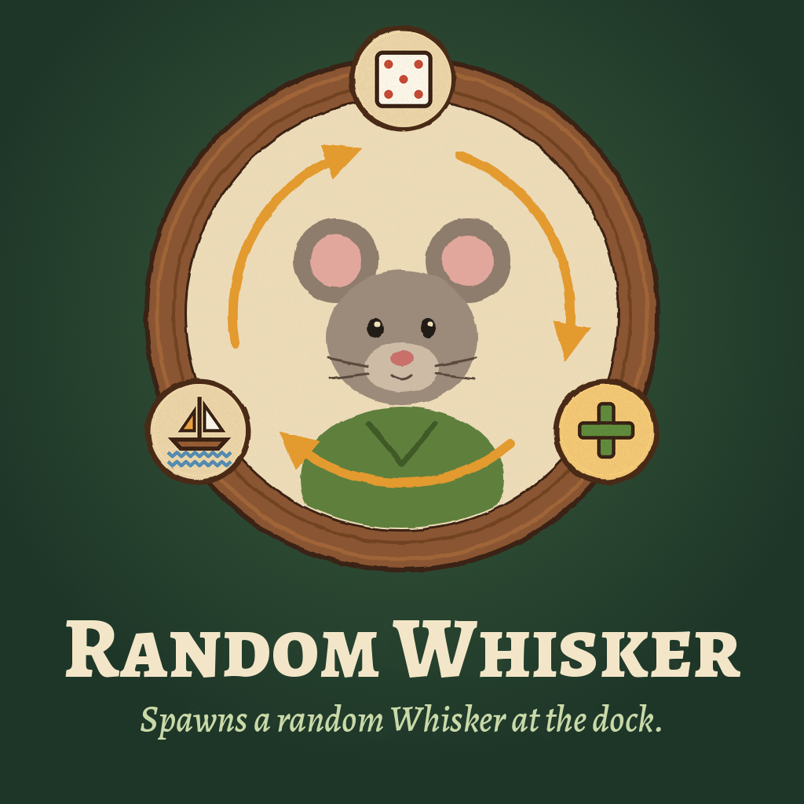

<div align="center">



# Random Whisker

**Spawn a random Whisker at the dock with one click.**

</div>

- A cat-head button sits at the left edge of the HUD, below Remote Campfire's icon.
- Each click brings one new Whisker to your dock.
- The game rolls name, look and traits. New Whiskers arrive without education.
- The button hides in menus, open windows and while saving.
- Tooltip in English and German; other languages use English.

## Download and Installation

**[Subscribe on Steam Workshop](https://steamcommunity.com/app/2489330/workshop/)**, then restart the game after Steam finishes downloading.

For manual installation, download `RandomWhisker-v0.1.0.zip` from the
[v0.1.0 release](https://github.com/repte/whiskerwood-random-whisker/releases/tag/v0.1.0).
Close the game and extract its `RandomWhisker` folder into:

```text
%LOCALAPPDATA%\Whiskerwood\Saved\mods\
```

Use either a local installation or a Workshop copy, never both.

## Compatibility

**Windows, Whiskerwood 0.7.209.0** (game build of 16 October 2026).

The mod calls the game's own spawn action `Arco_SpawnAgentsAtDock` and ships as ordinary
Blueprints, without a runtime DLL.

[Implementation and build instructions](docs/DEVELOPMENT.md)

---

Unofficial community mod built with the [Whiskerwood modkit](https://github.com/Whiskerwood-Modding/Whiskerwood-Project) by Buckminsterfullerene and Whiskerwood-Modding. Game assets belong to their respective owners.

[MIT license](LICENSE)

[](https://duoqueue.app/en/)
